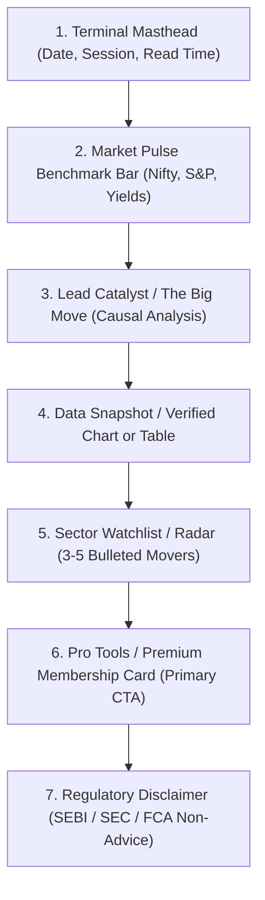

# Competitive Mailer Architecture & Design Playbook

> **Email Marketing Benchmarks, Layout Structures & Revenue Engines**
> Best Practices Derived from Leading Information Publishers, Financial Terminals, and High-Growth D2C Brands.

---

## 1. The Two Deliverable Variants

Every campaign send is benchmarked across two distinct delivery modes:

### Variant V1: Typographic Memo (Zero External Imagery)
- **Primary Job**: Guaranteed 100% primary-inbox deliverability, zero image clipping, ultra-fast mobile loading, and unvarnished editorial authority.
- **When to Use**: Breaking market alerts, CEO/editorial memos, high-frequency daily digests, winback nurture for cold lists, and plain-text executive readers.
- **Deliverability Engineering**:
  - Zero `data:` URI or heavy base64 strings (Gmail aggressively clips messages larger than 102KB, severing unsubscribe links and layouts).
  - Clean table structure with explicit inline font-family, line-height (1.6), and padding.
  - Typographic contrast created through font weights (700 bold vs 400 regular), border-left quote callouts, and clean horizontal dividers.

### Variant V2: Typographic + Visual Showcase
- **Primary Job**: Sensory persuasion, brand elevation, visual proof, and click-through acceleration.
- **When to Use**: Major product launches, visual market data breakdowns (verified charts), lifestyle collection drops, and weekend magazine editions.
- **Visual Sourcing Hierarchy**:
  1. Hosted verified product photo or verified data chart from CDN.
  2. Auto-generated animated GIF (2–4 smooth frames showing subtle product detail or chart transition).
  3. Photoreal editorial still lit in brand palette with ample negative space.
  - Never base64, never external placeholder image services.

---

## 2. Competitive Benchmarks & Section Architecture

### A. Information & Market Data Brands (Exemplars: Bloomberg, Seeking Alpha, Finshots)
Financial readers scan for catalysts, risk, and actionable perspective. They do not want shopping catalog grids.

- **Key Section Functions**:
  1. **Terminal Masthead**: Instantly sets the edition context (`Pre-Market Edition`, `Closing Bell`, `Weekend Macro Wrap`). Communicates respect for the reader's time (`3 min read`).
  2. **Market Pulse**: Scannable index readings strictly using real numbers.
  3. **Lead Catalyst**: The single biggest economic or company event. Explains *why* it moved and *second-order consequences*.
  4. **Data Snapshot**: A verified chart or clean comparison table. **Strictly prohibited: AI-hallucinated candlestick charts or fake price numbers.**
  5. **Sector Watchlist**: Concise bullet points with bolded lead tickers/sectors.
  6. **Pro Monetization Card**: The commercial engine: "Unlock complete valuation models, institutional screeners, and real-time trade alerts."
  7. **Regulatory Disclaimer**: Required non-advice educational statement tailored to the jurisdiction.

---

### B. News & Media Publishers (Exemplars: Axios Smart Brevity, Morning Brew, The Hustle)
Newsletters rely on reader retention and habit formation to drive sponsorship yield and subscription upgrades.

- **Axios "Smart Brevity" Principle**:
  - Every section opens with bold anchor words: **The big picture:**, **Why it matters:**, **By the numbers:**, **Between the lines:**, **What to watch:**.
  - This allows a reader to absorb 80% of the value in 45 seconds while rewarding full reads with nuanced analysis.
- **Section Sequence**:
  1. **Publication Header & Reading Time**: Distinctive masthead badge.
  2. **Top Story**: The day’s dominant event + "Why it matters".
  3. **Visual Editorial Slot**: High-resolution editorial photo or infographic.
  4. **In Other News (Quick Scans)**: 4 to 6 scannable bullet points across verticals.
  5. **Native Sponsored Placement**: Clear sponsor tag, styled seamlessly in editorial typography.
  6. **The Watercooler Item**: Intellectual dessert — fascinating trivia or cultural essay.
  7. **Colophon & Feedback Poll**: Interactive 1-click reader satisfaction rating (`Did you love this today? 👍 / 👎`).

---

### C. Commerce & D2C Brands (Exemplars: Glossier, Ridge, Gymshark, Apple)
Direct-response commerce emails drive measurable GMV and expand LTV.

- **Section Sequence**:
  1. **Hero Spotlight**: High-impact product still, crisp headline, primary purchase CTA.
  2. **Craft & Material Story**: Sensory details (water-resistant finish, full-grain leather, precision milling).
  3. **Curated Product Grid**: 2 to 4 complementary items or bestseller variations.
  4. **Social Proof Wall**: Authentic customer reviews with specific details (not generic praise).
  5. **Friction-Removal Strip**: Free shipping over threshold, 30-day returns, lifetime warranty.
  6. **Sticky Action Footer**: Final prominent CTA button.

---

## 3. High-Converting Ideation Hooks & Angles

| Angle Name | Commercial Psychology | Example Subject Line |
| :--- | :--- | :--- |
| **The Counter-Intuitive Shift** | Challenges consensus; exploits curiosity gap | *"Why falling rates won't rescue commercial real estate"* |
| **Smart Brevity 3-Minute Wrap** | Respects time; promises high signal-to-noise | *"Morning Brief: 3 moves before the opening bell"* |
| **The Origin Craft** | Justifies premium pricing through obsessive detail | *"Poured in small batches, cured over 14 days"* |
| **The Ripple Effect** | Connects macro catalyst to personal portfolio/routine | *"How the semiconductor export ban hits everyday tech"* |
| **The VIP Archive** | Creates exclusivity and reward without cheap discounts | *"Private access: Studio reserve pairs unlocked"* |
| **The Honest Comparison** | Lowers switching hesitation with objective evidence | *"Side-by-side: what actually changes when you upgrade"* |

---

## 4. Technical Deliverability Rules for All Mailers

1. **Max Content Width**: 600px centered table container for universal rendering across Outlook, Apple Mail, and Gmail.
2. **Client-Safe CSS**: All critical styles inlined on HTML elements. Avoid relying solely on `<style>` tags in `<head>` (which Gmail can strip).
3. **Outlook Background Colors**: Always supply explicit `bgcolor` attribute on table cells alongside `background-color` style.
4. **Image Alt Text**: Always provide descriptive, human-readable `alt` text so the email communicates full meaning even when images are disabled by default.
5. **No Broken Links**: Never invent URLs. If a specific product or section URL is not available, leave the CTA linking to the verified store/home domain.

---

## 6. Measured study (2026-10-18)

56 real sent emails from category leaders, read from Really Good Emails and measured as rendered in Chromium (`api/_shared/competitor-mail-study.js`, data in `data/benchmarks/mail-reference.json`). This is the reference set a brand's mailers follow until the competitive benchmarking feature has captured three or more emails from the brand's own competitors.

| Category | Emails | Subject chars | Headline words | Words | Picture before first button | Full-width first picture | Products side by side | Service strip | Shop-by row | Top button verbs |
|---|---|---|---|---|---|---|---|---|---|---|
| eyewear | 18 | 33 | 5 | 199 | 100% | 67% | 28% | 28% | 28% | Find, Shop, Get |
| apparel | 5 | 37 | 3 | 115 | 80% | 40% | 40% | 0% | 40% | Shop |
| footwear | 7 | 34 | 3 | 53 | 86% | 71% | 43% | 0% | 57% | Shop, Find, Head |
| beauty | 8 | 29 | 4 | 129 | 100% | 25% | 50% | 0% | 25% | Shop, Get, View |
| food | 7 | 35 | 3 | 134 | 86% | 29% | 43% | 0% | 57% | Get, Watch, More |
| news | 4 | 37 | 6 | 281 | 100% | 50% | 25% | 0% | 50% | Explore, See, Join |
| winback | 7 | 29 | 7 | 144 | 100% | 14% | 14% | 14% | 29% | Shop, View, Sign |
| **all** | 56 | 34 | 4 | 137 | 95% | 46% | 34% | 11% | 38% | Shop, Get, Find |

What the mailers take from it: a short headline (a reason, never a product code) above a full-width picture, one button with a specific verb, the other products side by side with their own photos and prices, and a promise strip or shop-by row only when the brand's own record can fill it. Shape only: no competitor's words, offers, claims or pictures.
