# Competitive Landing Page & Conversion Architecture Playbook

> **Direct-Response Presell, Subscription Opt-In & Paywall Frameworks**
> Standards for High-Converting Web Landers Across Information, Financial, and Commerce Verticals.

---

## 1. Landing Page Architecture by Commercial Model

A landing page succeeds or fails based on whether its layout matches the visitor's decision friction:

```mermaid
graph TD
    subgraph "Information & Media Brands"
        A1["1. Sticky Edition Alert Bar"] --> B1["2. Hero: Value Proposition + 1-Click Form"]
        B1 --> C1["3. Social Proof Bar (Subscriber & Media Logos)"]
        C1 --> D1["4. Sample Issue / Analysis Preview Snippet"]
        D1 --> E1["5. Free vs Pro Feature Comparison Matrix"]
        E1 --> F1["6. Named Professional Quotes / Testimonials"]
        F1 --> G1["7. Privacy / 1-Click Unsubscribe Guarantee"]
    end

    subgraph "Commerce & D2C Brands"
        A2["1. Sticky Shipping / Offer Countdown Bar"] --> B2["2. Hero: Headline + Buy Box + Gallery"]
        B2 --> C2["3. Us vs Traditional Market Alternatives Table"]
        C2 --> D2["4. Craft / Ingredient / Material Deep-Dive"]
        D2 --> E2["5. Tiered Bundle Ladder (Good / Better / Best)"]
        E2 --> F2["6. Verified Buyer Photo Reviews"]
        F2 --> G2["7. 30-Day Money-Back Risk-Reversal Guarantee"]
    end
```

---

## 2. Key Sections & Psychological Functions

### 1. Sticky Notification / Urgency Bar
- **Information Brands**: Next issue drop time (e.g. *"Tomorrow's Pre-Market Briefing drops at 7:30 AM EST — Join 85,000+ Readers"*).
- **Commerce Brands**: Honest fulfillment or shipping thresholds (e.g. *"Free worldwide shipping on orders over $75 · 30-day money-back guarantee"*).

### 2. The Above-the-Fold Hero
- The visitor must understand **who it is for, what they get, and how to take action without scrolling**.
- **Information Lander Form**: A single input field for email and a high-contrast submit button. Zero multi-step friction.
- **Commerce Lander Form**: Clear price display, compare-at pricing, colorway or size selector, and immediate Add-to-Cart / Buy Now button.

### 3. The Evidence Preview
- Visitors do not buy blind promises.
- **Information Brands**: Embed an actual 2-paragraph sample from a recent edition or an interactive preview of a sector analysis report. Demonstrates tangible intellectual depth.
- **Commerce Brands**: Macro product photography or 3-step ritual sequence showing real-world application.

### 4. Comparison Matrix (Us vs Them / Free vs Pro)
- Visually establishes asymmetrical value:
  - *"Traditional Financial News" (Slow, 50 tabs, ad-cluttered, sensory overload) vs "Our Daily Intelligence" (4 min, curated, zero fluff, actionable catalysts).*
  - *"Free Edition" (Daily Morning Memo) vs "Pro Intelligence" (Real-time breakout alerts, institutional DCF models, weekly portfolio rebalancing).*

### 5. Bundle Ladder & AOV Expansion (Commerce)
- Never offer only a single SKU. Structure a 3-tier value ladder:
  - **Tier 1 (Starter)**: Single unit at regular price.
  - **Tier 2 (Most Popular / Best Value)**: Pack of 3 or Complete System with bundled accessories (lifts AOV by 40–60%).
  - **Tier 3 (VIP / Collector)**: Limited edition archive case + full accessory suite.

### 6. Risk-Reversal & Guarantee
- Eliminates the psychological barrier to checkout or signup.
  - Information: *"100% Free. No spam, ever. 1-click unsubscribe at any time."*
  - Paid Pro: *"Try Pro for 30 days. If it doesn't give you at least one actionable market edge, email us for a full refund. No questions asked."*
  - Commerce: *"Try it for 30 days. If you don't love it, send it back for a prompt refund."*

---

## 3. Technical Performance Standards

1. **Self-Contained Document**: The landing page must be output as a single, valid HTML file starting with `<!doctype html>` and ending with `</html>`.
2. **Inline CSS**: All styling must live inside an embedded `<style>` block in the head. No external CSS frameworks (e.g. external Tailwind CDN links) that cause layout shifts (CLS) or render-blocking delays.
3. **Sub-1.2s First Contentful Paint**: Clean HTML/CSS without bloated JavaScript dependencies guarantees instant loading even on slow 4G mobile connections.
4. **Mobile Sticky CTA**: On screens ≤ 768px, a fixed bottom bar with a one-tap CTA ensures the user never has to hunt for the conversion button after scrolling.
